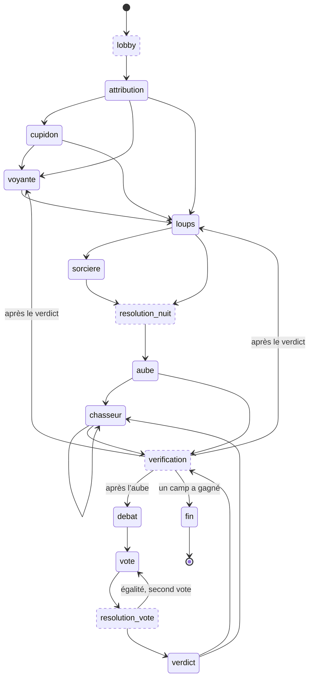

# La machine à états du jeu

Le moteur (`src/game/engine.ts`) fait avancer la partie d'**état en état**. Chaque changement
passe par une seule fonction, `goto`, qui **refuse toute transition absente de la table
`TRANSITIONS`**. Les tests rejouent des centaines de parties et vérifient que l'historique ne
contient que des transitions autorisées.

## Schéma

Les états en pointillé sont « de passage » : la partie les traverse instantanément, mais ils sont
inscrits dans l'historique.

## Correspondance avec le plan

| Étape du plan | États du moteur |
| --- | --- |
| Lobby | `lobby` |
| Attribution | `attribution` (en attente de l'événement « démarrer ») |
| Nuit | `cupidon` (1re nuit), `voyante`, `loups`, `sorciere` |
| Résolution nuit | `resolution-nuit` |
| Jour | `aube` (annonce des morts), puis `chasseur` si besoin |
| Vérification victoire | `verification` (après l'aube et après le verdict) |
| Discussion | `debat` |
| Vote | `vote` |
| Résolution vote | `resolution-vote`, puis `verdict` (annonce) |
| Fin | `fin` |

## Événements

Une partie n'évolue qu'au moyen de trois événements, traités par `applyEvent(état, événement)` :

- `demarrer` : l'hôte lance la première nuit ;
- `tic` : l'horloge avance. Si le chrono de la phase est écoulé (`phaseEndsAt`), ou si tous les
  joueurs attendus (`pending`) ont agi, la phase se termine ;
- `action` : un joueur agit (vote, choix de nuit, message…). L'action est d'abord vérifiée par
  `validateAction`, qui renvoie la raison d'un refus. Une action refusée ne change rien.

## Propriétés garanties (et testées)

- **Reproductible** : le hasard vient d'une graine stockée dans l'état. Même état + mêmes
  événements ⇒ même partie.
- **Sérialisable** : l'état ne contient que des données (JSON), prêt à être stocké en base.
- **Multijoueur** : plusieurs humains peuvent jouer la même partie (plusieurs loups humains
  votent à la majorité, chacun reçoit ses informations secrètes dans `notes`).
- **Pas de chat en mode « même pièce »** : seules les annonces du meneur sont conservées.

À l'étape 4, ces règles seront reprises côté serveur (fonctions SQL), qui deviendra la source de
vérité. Ce moteur restera la référence pour les parties contre les robots et pour les tests.
